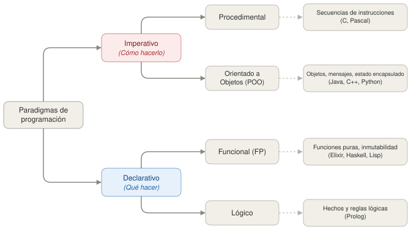

# Paradigmas de programación

Un **paradigma de programación** es una forma de plantear y organizar la solución de un problema mediante un conjunto de conceptos y principios que orientan cómo se representan los datos y cómo se expresan las operaciones de un programa.

Un mismo problema puede resolverse de diferentes maneras según el paradigma utilizado. Por ejemplo, para sumar los números pares de una lista, una solución puede indicar paso a paso cómo recorrerla, identificar los números pares y acumular su suma. Otra puede centrarse en expresar qué elementos se deben seleccionar y qué operación se debe realizar sobre ellos, sin describir explícitamente cada paso del recorrido.

Un mismo lenguaje puede **admitir varios paradigmas**. Java, por ejemplo, permite utilizar un enfoque imperativo y también incorpora características de programación funcional. Por tanto, el paradigma no depende exclusivamente del lenguaje, sino también de la forma en que se plantea y expresa la solución.


## Principales paradigmas de programación

El siguiente diagrama resume los principales paradigmas de programación y sus características:



Existen otros paradigmas además de los que se presentan aquí (por ejemplo, el **lógico**, representado por Prolog, o el **reactivo**). Esta guía se concentra en la división entre el enfoque **imperativo** y el **declarativo/funcional**.

---

## El enfoque imperativo: dando órdenes

La programación imperativa se centra en describir **cómo** debe realizarse una tarea. El código es una secuencia de instrucciones explícitas que modifican el estado del programa paso a paso. Es como dar una receta detallada a un cocinero: "primero, corta las cebollas; segundo, calienta el aceite; tercero, añade las cebollas a la sartén".

### Programación procedimental

La **programación procedimental** organiza el programa como una secuencia de instrucciones, agrupadas en procedimientos o funciones, que modifican variables paso a paso.

#### Ejemplo en Java (estilo procedimental)

El siguiente ejemplo suma los números pares de una lista. Aunque está escrito en Java, un lenguaje orientado a objetos, el código no utiliza objetos para organizar la solución y sigue un estilo **procedimental**, porque describe cada paso y modifica la variable `sumaPares` en cada iteración. El código usa la sintaxis de Java 25, que permite escribir un programa sencillo con solo el método `main`, sin declarar una clase.

```java
import java.util.List;

void main() {
    List<Integer> numeros = List.of(1, 2, 3, 4, 5, 6);
    int sumaPares = 0; // 1. Se inicializa una variable de estado

    for (int numero : numeros) { // 2. Se itera sobre la colección
        if (numero % 2 == 0) {
            sumaPares += numero; // 3. Se modifica el estado en cada paso
        }
    }
    // El resultado final depende de todas las mutaciones anteriores
    System.out.println("La suma de los pares es: " + sumaPares); // Salida: 12
}
```

### Programación orientada a objetos (POO)

La **programación orientada a objetos (POO)** organiza el programa alrededor de **objetos**, que agrupan datos (atributos) y comportamientos (métodos), y se apoya en principios como el **encapsulamiento**, la **herencia** y el **polimorfismo**. Se presenta junto al enfoque imperativo porque gran parte del código orientado a objetos utiliza instrucciones secuenciales y, en muchos casos, estado mutable. Sin embargo, la POO no es exclusivamente imperativa y puede combinarse con ideas y técnicas de otros paradigmas.

#### Ejemplo en Java (estado mutable en un objeto)

El encapsulamiento busca que el estado interno de un objeto solo cambie mediante sus propios métodos. Sin embargo, cuando un atributo es mutable y el objeto entrega una referencia a él, otras partes del programa pueden modificarlo directamente. En el siguiente ejemplo, la clase `Curso` guarda las notas en un atributo privado, pero el método `getNotas` devuelve la misma lista que utiliza internamente.

```java
import java.util.ArrayList;
import java.util.List;

class Curso {
    private final List<Double> notas = new ArrayList<>(); // Atributo privado

    public void agregarNota(double nota) {
        notas.add(nota);
    }

    public List<Double> getNotas() {
        return notas; // Devuelve la misma lista, no una copia
    }
}

public class Main {
    public static void main(String[] args) {
        Curso curso = new Curso();
        curso.agregarNota(4.5);
        curso.agregarNota(2.0);

        List<Double> notas = curso.getNotas();
        notas.clear(); // Se modifica el estado interno del objeto desde fuera de la clase

        System.out.println(curso.getNotas()); // Salida: []
    }
}
```

La llamada a `clear` también vacía las notas del objeto `curso`, porque la variable `notas` y el atributo del objeto hacen referencia a la misma lista en memoria. Este tipo de errores es difícil de rastrear, ya que la modificación ocurre lejos de la clase que define el estado.

---

## El enfoque declarativo: describiendo el resultado

La programación declarativa se centra en describir **qué** se quiere lograr, sin detallar los pasos para conseguirlo. La lógica del "cómo" se abstrae. Siguiendo la analogía, sería como pedirle a un chef "un plato de pasta con salsa de tomate", sin especificarle cómo cortar los tomates o hervir la pasta.

### Programación funcional (FP)

La programación funcional es el principal paradigma declarativo. Trata la computación como la evaluación de funciones matemáticas y se apoya en principios como la **inmutabilidad** (los datos no se modifican una vez creados) y las **funciones puras** (el resultado depende solo de los argumentos).

#### Ejemplo en Java (estilo funcional)

El siguiente ejemplo resuelve el mismo problema de sumar los pares utilizando la API de Streams de Java, que permite un estilo más declarativo.

```java
import java.util.List;

public class SumadorFuncional {
    public static void main(String[] args) {
        List<Integer> numeros = List.of(1, 2, 3, 4, 5, 6);

        int sumaPares = numeros.stream()  // 1. Convierte la lista en un stream de datos
                               .filter(n -> n % 2 == 0) // 2. Selecciona solo los pares
                               .mapToInt(Integer::intValue) // 3. Convierte a un stream de enteros primitivos
                               .sum(); // 4. Suma los valores restantes

        System.out.println("La suma de los pares es: " + sumaPares); // Salida: 12
    }
}
```
Este código es declarativo, porque no se indica "crea un acumulador, itera, comprueba, suma..." sino que se declara una secuencia de transformaciones sobre los datos, primero filtrar los pares (`filter`) y luego sumarlos (`sum`). El recorrido de la lista y la variable que acumula la suma quedan dentro de la API de Streams, y el programador no los escribe.

Como esta solución no modifica variables durante el recorrido, la misma operación puede ejecutarse en paralelo reemplazando `stream()` por `parallelStream()`, sin alterar el resultado. En la versión imperativa, en cambio, si varios hilos actualizaran al mismo tiempo la variable `sumaPares`, el resultado podría ser incorrecto a menos que se sincronice el acceso a ella. Esta relación entre inmutabilidad y concurrencia es una de las principales ventajas del paradigma funcional.

---

## Lenguajes multiparadigma

Aunque muchos lenguajes modernos son **multiparadigma**, suelen tener un paradigma dominante que influye en su diseño y ecosistema. Java y C# tienen su raíz en la POO, mientras que lenguajes como Haskell, Erlang, Elixir o Clojure se diseñaron desde el principio como lenguajes funcionales.

---

## ¿Por qué Elixir?

Java incorpora características funcionales, como las expresiones lambda y la API de Streams, pero no obliga a utilizarlas, ya que sus variables y la mayoría de sus colecciones son mutables por defecto. En un lenguaje diseñado como funcional, la inmutabilidad y la composición de funciones son la forma habitual de programar, y lo aprendido puede aplicarse después en lenguajes multiparadigma como Java.

Por eso se utilizará **Elixir**, un lenguaje funcional moderno con una sintaxis clara, un modelo de concurrencia basado en procesos ligeros y mecanismos de tolerancia a fallos que permiten construir sistemas confiables y escalables.

### De Java a Elixir

Pasar de Java a Elixir implica reemplazar varias construcciones habituales de la POO por otras propias del paradigma funcional. La siguiente tabla resume las correspondencias principales a nivel conceptual:

| En Java                                             | En Elixir                                                                       |
| :-------------------------------------------------- | :------------------------------------------------------------------------------ |
| Clases que agrupan atributos y métodos.             | Módulos que agrupan funciones. Los datos se manejan por separado.               |
| Objetos cuyo estado cambia mediante sus métodos.    | Datos inmutables. Cada operación produce un nuevo dato en lugar de modificarlo. |
| Ciclos `for` y `while` con variables que cambian.   | Recursión y funciones que operan sobre colecciones.                             |
| Excepciones y `null` para representar errores.      | Se prefieren valores de retorno que indican si la operación tuvo éxito o falló. |
| Hilos que comparten memoria.                        | Procesos aislados que se comunican mediante el envío de mensajes.               |
| Tipado estático, verificado durante la compilación. | Tipado dinámico, verificado durante la ejecución.                               |

---

## Para la próxima clase

### Actividad de cierre (sin escribir código)

Tome el siguiente problema: *dada una lista de notas de un curso, obtener el promedio únicamente de las notas aprobatorias (mayores o iguales a 3.0)*.

Complete la siguiente tabla comparando cómo abordaría el problema desde cada enfoque. Puede apoyarse en los ejemplos en Java de esta guía.

| Aspecto                                                                     | Enfoque imperativo | Enfoque declarativo/funcional |
| :-------------------------------------------------------------------------- | :----------------- | :---------------------------- |
| ¿Qué se describe: el **cómo** o el **qué**?                                 |                    |                               |
| ¿Qué variables cambian de valor durante la ejecución?                       |                    |                               |
| ¿Quién controla la iteración: usted o el lenguaje?                          |                    |                               |
| ¿Qué pasos podrían ejecutarse en paralelo sin romper el resultado?          |                    |                               |
| Si el resultado sale mal, ¿qué tendría que revisar para encontrar el error? |                    |                               |

Responda además las siguientes preguntas:

- ¿Qué ocurre en cada solución si ninguna nota es aprobatoria?
- Suponga que, mientras se calcula el promedio, otra parte del programa agrega o elimina notas de la misma lista, como en el ejemplo de la clase `Curso`. ¿Qué podría ocurrir con el resultado? ¿Cambiaría algo si la lista no pudiera modificarse después de creada?

### Preparación

- Investigue sobre el lenguaje **Elixir** y su paradigma funcional. Puede consultar la documentación oficial en [https://elixir-lang.org/](https://elixir-lang.org/).
- Qué se necesita para empezar a programar en Elixir (instalación, herramientas, etc.).
- Investigue sobre el lenguaje **Erlang** y su relación con Elixir. Puede consultar la documentación oficial en [https://www.erlang.org/](https://www.erlang.org/).
