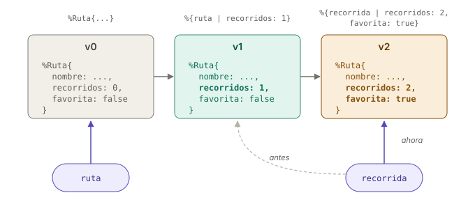

# Structs

Los **structs** en Elixir son mapas con un conjunto fijo de campos, asociados a un módulo. A diferencia de un mapa genérico, un struct declara por anticipado los campos que puede contener, lo que permite conocer su estructura a partir de su definición y detectar de inmediato el uso de un campo inexistente.

Se utilizan para representar entidades con una estructura definida, como usuarios, productos o pedidos.

## Diferencias entre Structs y Mapas

Internamente **un struct es un mapa**, así que ocupa la misma memoria y es igual de rápido. La diferencia está en que sus claves son fijas y pertenecen a un módulo, de modo que cada struct tiene siempre la forma esperada y un error al escribir una clave se detecta de inmediato.

### Comparación práctica

A continuación se muestra un ejemplo que intenta crear un struct con una clave no definida:

```elixir
defmodule Usuario do
  defstruct [:nombre, :edad]
end

defmodule Comparacion do
  def main do
    # Mapa: admite cualquier clave
    mapa = %{nombre: "Juan", edad: 30, telefono: "123"}
    IO.inspect(mapa)

    # Struct: solo admite las claves definidas
    usuario = %Usuario{nombre: "Juan", edad: 30, telefono: "123"}
    IO.inspect(usuario)
  end
end

Comparacion.main()
```

Al ejecutarlo, el programa no alcanza a mostrar nada y se detiene con el error `** (KeyError) key :telefono not found`, porque `telefono` no está definido en `Usuario`. Quite el teléfono del struct y vuelva a ejecutarlo para ver ambos valores.

---

## Ejemplo 1: Rutas de ciclismo

Una aplicación de ciclismo necesita representar las rutas que sus usuarios suelen recorrer. De cada ruta interesa su nombre, la ciudad donde inicia y su distancia en metros. Además, la aplicación debe llevar la cuenta de cuántas veces se ha recorrido cada ruta y permitir marcarla como favorita.

Iremos construyendo la solución por versiones, agregando una capacidad nueva en cada paso.

### Versión 1: Definir el struct

La primera decisión es qué campos tendrá la ruta. Para definir un struct se usa `defstruct` dentro de un módulo. La forma más simple es dar una **lista de átomos** con los nombres de los campos:

```elixir
defmodule Ruta do
  defstruct [:nombre, :ciudad, :distancia, :recorridos, :favorita]
end

defmodule AppCiclismo do
  def main do
    ruta = %Ruta{nombre: "Armenia - Salento", ciudad: "Armenia", distancia: 24350}
    IO.inspect(ruta)
  end
end

AppCiclismo.main()
# => %Ruta{nombre: "Armenia - Salento", ciudad: "Armenia", distancia: 24350,
#          recorridos: nil, favorita: nil}
```

> ⚠️ **Importante:** el struct debe crearse **dentro de una función**. Si se crea por fuera de una función, se muestra el error `cannot access struct Ruta, the struct was not yet defined`.

El problema de esta versión es que `recorridos` queda en `nil`. Una ruta recién creada debe tener **cero recorridos**, no un valor indefinido. De igual forma, inicialmente no es una ruta favorita. Además, si `recorridos` contiene `nil`, no sería posible sumarle 1 al contador.

### Versión 2: Valores por defecto

`defstruct` permite asignar un **valor inicial** a cada campo usando la sintaxis `campo: valor`:

```elixir
defmodule Ruta do
  defstruct nombre: "", ciudad: "", distancia: 0, recorridos: 0, favorita: false
end
```

Sin embargo, aquí conviene distinguir dos tipos de campos: los que **siempre deben venir de afuera** (nombre, ciudad, distancia) y los que **tienen un valor inicial natural** (recorridos y favorita). Para eso existe la **forma mixta**, que combina la lista de átomos con los valores por defecto. Los campos sin valor por defecto se escriben primero:

```elixir
defmodule Ruta do
  defstruct [:nombre, :ciudad, :distancia, recorridos: 0, favorita: false]
end
```

Con el mismo `AppCiclismo` de la Versión 1, que no cambia, la salida ya es otra:

```
%Ruta{
  nombre: "Armenia - Salento",
  ciudad: "Armenia",
  distancia: 24350,
  recorridos: 0,
  favorita: false
}
```

Ahora, una ruta nueva se crea automáticamente con el contador de recorridos en cero y sin estar marcada como favorita, sin que quien la cree tenga que especificarlo.

> ⚠️ **Importante:** en la forma mixta, los campos **sin** valor por defecto deben ir **antes** que los que sí lo tienen. Escribir `defstruct [recorridos: 0, :nombre]` produce un error de sintaxis.

### Versión 3: Acceder a los campos

Para mostrar la información de la ruta necesitamos leer sus campos. Hay dos maneras de hacerlo:

```elixir
defmodule AppCiclismo do
  def main do
    ruta = %Ruta{nombre: "Armenia - Salento", ciudad: "Armenia", distancia: 24350}

    # 1. Acceso con punto
    IO.puts("La ruta #{ruta.nombre} inicia en #{ruta.ciudad}")
    # => La ruta Armenia - Salento inicia en Armenia

    # 2. Pattern matching: extrae varios campos a la vez
    %Ruta{nombre: nombre, distancia: distancia} = ruta
    IO.puts("#{nombre} mide #{div(distancia, 1000)} km y #{rem(distancia, 1000)} metros")
    # => Armenia - Salento mide 24 km y 350 metros
  end
end
```

El **pattern matching** es especialmente útil cuando se necesitan varios campos, ya que evita repetir el nombre de la variable una y otra vez. Además, funciona en los parámetros de una función.

> ⚠️ **Importante:** a diferencia de los mapas, los structs **no admiten el acceso con corchetes**. Escribir `ruta[:nombre]` produce un `UndefinedFunctionError`. Use siempre el punto o el pattern matching.

### Versión 4: Actualizar campos (inmutabilidad)

Cada vez que el ciclista completa la ruta hay que incrementar su contador. Como los structs son **inmutables**, no se modifica la ruta existente: se crea una nueva a partir de ella con la sintaxis de actualización `%{struct | campo: valor}`.

```elixir
defmodule AppCiclismo do
  def main do
    ruta = %Ruta{nombre: "Armenia - Salento", ciudad: "Armenia", distancia: 24350}

    # Cada actualización produce un struct NUEVO
    recorrida = %{ruta | recorridos: ruta.recorridos + 1}
    recorrida = %{recorrida | recorridos: recorrida.recorridos + 1, favorita: true}

    IO.puts("Original:    #{ruta.recorridos} recorridos")      # => Original:    0 recorridos
    IO.puts("Actualizada: #{recorrida.recorridos} recorridos") # => Actualizada: 2 recorridos
  end
end
```

La ruta original **nunca cambia**: `ruta` sigue con cero recorridos. Esto es lo mismo que vimos con los mapas y las listas, y es la razón por la que cada función que "modifica" un struct debe **retornar** la nueva versión.

El siguiente diagrama muestra las tres versiones de la ruta que existen en memoria al ejecutar `main`:



La variable `ruta` sigue asociada a la versión original `v0`, mientras que `recorrida` se asocia primero a `v1` y luego a `v2`. Si el resultado de una actualización no se asigna a una variable, la nueva versión se pierde.

La sintaxis `%{struct | campo: valor}` solo permite actualizar campos **que ya existen** en el struct. Si intenta `%{ruta | dificultad: "alta"}`, obtendrá un error, porque `dificultad` no está definido en `defstruct`.

Como un struct es un mapa, esta misma sintaxis sirve para actualizar un mapa, y también falla si la clave no existe en él.

### Versión 5: Campos obligatorios con `@enforce_keys`

Hay un hueco en el diseño actual: nada impide crear una ruta vacía.

```elixir
ruta = %Ruta{}
# => %Ruta{nombre: nil, ciudad: nil, distancia: nil, recorridos: 0, favorita: false}
```

En una aplicación de ciclismo, una ruta sin nombre ni distancia no es un dato válido. La directiva `@enforce_keys` declara qué campos son **obligatorios** al construir el struct:

```elixir
defmodule Ruta do
  @enforce_keys [:nombre, :ciudad, :distancia]
  defstruct [:nombre, :ciudad, :distancia, recorridos: 0, favorita: false]
end
```

A partir de ahora, omitir cualquiera de esos tres campos impide que el programa compile:

```elixir
%Ruta{nombre: "Alto de La Línea"}
# ** (ArgumentError) the following keys must also be given when building
#    struct Ruta: [:ciudad, :distancia]
```

`@enforce_keys` **solo exige que el campo se proporcione**, pero no valida su contenido. Nada impide escribir `%Ruta{nombre: "", ciudad: "", distancia: -50}`.

### Versión 6 (final): Funciones en el módulo del struct

Hasta ahora, toda la lógica está en `AppCiclismo`, que además de utilizar la ruta, implementa las operaciones necesarias para incrementar el contador y convertir la distancia. Si otro módulo necesitara trabajar con una ruta, tendría que repetir esa lógica.

Es preferible que las funciones que operan sobre una ruta se definan en el módulo `Ruta`, de modo que otros módulos solo necesiten invocar `Ruta.recorrer/1`, sin conocer cómo se modifican internamente sus datos.

```elixir
defmodule Ruta do
  @enforce_keys [:nombre, :ciudad, :distancia]
  defstruct [:nombre, :ciudad, :distancia, recorridos: 0, favorita: false]

  def recorrer(%Ruta{recorridos: n} = ruta) do
    %{ruta | recorridos: n + 1}
  end

  def marcar_favorita(%Ruta{} = ruta), do: %{ruta | favorita: true}

  def distancia_formateada(%Ruta{distancia: metros}) do
    "#{div(metros, 1000)} km y #{rem(metros, 1000)} metros"
  end

  def frecuente?(%Ruta{recorridos: n}), do: n >= 3
end

defmodule AppCiclismo do
  def main do
    ruta =
      %Ruta{nombre: "Armenia - Salento", ciudad: "Armenia", distancia: 24350}
      |> Ruta.recorrer()
      |> Ruta.recorrer()
      |> Ruta.recorrer()
      |> Ruta.marcar_favorita()

    IO.puts("#{ruta.nombre}, desde #{ruta.ciudad} (#{Ruta.distancia_formateada(ruta)})")
    IO.puts("Recorridos: #{ruta.recorridos}")
    IO.puts("¿Es frecuente? #{Ruta.frecuente?(ruta)}")
  end
end

AppCiclismo.main()
```

La salida es:

```
Armenia - Salento, desde Armenia (24 km y 350 metros)
Recorridos: 3
¿Es frecuente? true
```

Las funciones de `Ruta` presentan dos aspectos importantes:

1. Reciben el struct por pattern matching (`%Ruta{recorridos: n} = ruta`). De esta forma se extrae el campo necesario y, al mismo tiempo, se **garantiza que el argumento sea una ruta**. Si se pasara un mapa cualquiera, la función fallaría de inmediato. El campo también podría leerse con `ruta.recorridos`, como en la versión 4, pero sin `%Ruta{}` en el parámetro la función aceptaría cualquier mapa que tenga esa clave.
2. `recorrer/1` se puede encadenar con el operador pipe, porque **recibe una ruta y retorna una ruta**. Es la forma habitual de trabajar con datos inmutables en Elixir, mediante una secuencia de transformaciones en la que cada paso produce una nueva versión del dato.

---

## Ejemplo 2: Pokédex de un entrenador

Un entrenador Pokémon quiere llevar el control de los Pokémon que ha capturado y de los movimientos que cada uno conoce. Cada Pokémon tiene un número de Pokédex, un nombre, un nivel y una lista de movimientos aprendidos. Un Pokémon solo puede conocer hasta **cuatro movimientos** al mismo tiempo.

Se requiere implementar las siguientes funcionalidades:
- Registrar un nuevo Pokémon y agregarlo a una colección
- Actualizar la información de un Pokémon
- Liberar un Pokémon
- Enseñarle un movimiento a un Pokémon
- Hacer que un Pokémon olvide un movimiento
- Buscar un Pokémon por su número de Pokédex
- Listar todos los Pokémon

### 1. Crear el struct `Pokemon`

Al igual que `Ruta`, el módulo `Pokemon` tiene campos obligatorios y funciones que reciben el struct por pattern matching. Sin embargo, aquí aparece un requisito nuevo. `@enforce_keys` garantiza que se proporcionen el nombre y el nivel, pero no que el nivel sea válido, y un Pokémon de nivel 0 o 150 no lo es. Por eso, en lugar de construir `%Pokemon{...}` directamente, se define una función `nuevo/2` que revisa los datos antes de crear el struct.

```elixir
defmodule Pokemon do
  @enforce_keys [:nombre, :nivel]
  defstruct [:nombre, :nivel, movimientos: []]

  # El límite de movimientos es una regla del dominio, no un número suelto en el código
  @max_movimientos 4

  # Constructor con validación
  def nuevo(nombre, nivel) when nivel > 0 and nivel <= 100 do
    {:ok, %__MODULE__{nombre: nombre, nivel: nivel}}
  end

  def nuevo(_nombre, _nivel), do: {:error, :nivel_invalido}

  # Actualización con la misma validación del constructor
  def actualizar(%__MODULE__{} = pokemon, nombre, nivel) when nivel > 0 and nivel <= 100 do
    {:ok, %{pokemon | nombre: nombre, nivel: nivel}}
  end

  def actualizar(%__MODULE__{}, _nombre, _nivel), do: {:error, :nivel_invalido}

  # --------------------- Funciones de utilidad relacionadas con el struct ---------------------

  def aprender_movimiento(%__MODULE__{movimientos: movimientos} = pokemon, movimiento) do
    cond do
      conoce_movimiento?(pokemon, movimiento) -> {:error, :ya_lo_conoce}
      length(movimientos) >= @max_movimientos -> {:error, :movimientos_llenos}
      true -> {:ok, %{pokemon | movimientos: [movimiento | movimientos]}}
    end
  end

  def olvidar_movimiento(%__MODULE__{movimientos: movimientos} = pokemon, movimiento) do
    {:ok, %{pokemon | movimientos: List.delete(movimientos, movimiento)}}
  end

  def conoce_movimiento?(%__MODULE__{movimientos: movimientos}, movimiento) do
    Enum.member?(movimientos, movimiento)
  end
end
```

`nuevo/2` es un **constructor**, es decir, la función que se utiliza para crear Pokémon en lugar de construir `%Pokemon{...}` directamente. Como la creación puede fallar, no devuelve únicamente el Pokémon, sino `{:ok, pokemon}` o `{:error, :nivel_invalido}`, y quien la invoca distingue los dos casos con un `case` o un `with`.

`actualizar/3` aplica la misma validación al modificar un Pokémon que ya existe. Sin ella, bastaría con escribir `%{pokemon | nivel: 150}` para saltarse la regla que protege `nuevo/2`.

En `Ruta`, `recorrer/1` siempre podía sumar un recorrido, así que retornaba la ruta directamente. Aprender un movimiento, en cambio, puede fallar, por eso `aprender_movimiento/2` retorna `{:ok, pokemon}` o `{:error, razon}`. Además tiene **dos motivos distintos de falla**, y por eso se usa `cond` en lugar de `if`. Cada rama devuelve un error diferente y quien llama a la función puede distinguirlos.

> ⚠️ **Importante:** Dentro del módulo, `%__MODULE__{}` se refiere al **struct definido en el módulo actual**, en este caso `%Pokemon{}`. Evita repetir el nombre y hace que el código siga funcionando si el módulo se renombra. Ambas formas son válidas.

### 2. Crear el módulo `Pokedex`

El módulo `Pokedex` va a tener la lógica para manejar los Pokémon capturados. Se usará un mapa para almacenarlos, porque da acceso rápido a los datos mediante una clave única, el número de Pokédex. El mapa empieza vacío, `%{}`.

### 3. Implementar las funcionalidades

Las siguientes funciones van dentro del módulo `Pokedex` y manejan los Pokémon y los movimientos que aprenden.

Ya vimos que las funciones de `Pokemon` no modifican el struct que reciben, sino que retornan uno nuevo. Con el mapa `pokemones` pasa lo mismo. Como el **mapa es inmutable**, cada función del `Pokedex` que lo modifica debe retornar una nueva versión del mapa con los cambios aplicados.

#### Registrar un nuevo Pokémon

Registrar un Pokémon es agregar una clave nueva al mapa `pokemones`. Aquí no sirve la sintaxis `%{pokemones | numero => pokemon}`, porque falla cuando la clave no existe, y un Pokémon nuevo todavía no está en el mapa. Para agregar claves se usa `Map.put/3`, que recibe el mapa, la clave y el valor, y devuelve un mapa nuevo con la clave agregada.

Una versión simple de la función para registrar un Pokémon sería:

```elixir
def registrar_pokemon(pokemones, numero, nombre, nivel) do
  nuevo_pokemon = %Pokemon{nombre: nombre, nivel: nivel, movimientos: []}
  # Retorna un nuevo mapa con el Pokémon agregado
  Map.put(pokemones, numero, nuevo_pokemon)
end
```

Sin embargo, antes de agregar el Pokémon hay que validar dos cosas. El número no debe estar registrado, y el nivel debe ser válido, algo que ya revisa `Pokemon.nuevo/2`. Como ambas validaciones pueden fallar, se encadenan con `with`. Si alguna no retorna lo esperado, `with` se detiene y retorna ese error tal cual, por lo que no se necesita un bloque `else`.

```elixir
def registrar_pokemon(pokemones, numero, nombre, nivel) do
  with :ok <- verificar_numero_libre(pokemones, numero),
       {:ok, nuevo_pokemon} <- Pokemon.nuevo(nombre, nivel) do
    # Retorna un nuevo mapa con el Pokémon agregado
    {:ok, Map.put(pokemones, numero, nuevo_pokemon)}
  end
end

defp verificar_numero_libre(pokemones, numero) do
  if Map.has_key?(pokemones, numero), do: {:error, :numero_duplicado}, else: :ok
end
```

Las funciones del `Pokedex` que pueden fallar retornan una tupla `{:ok, resultado}` o `{:error, razon}`, de modo que el error viaja explícito hacia quien las llamó.

#### Obtener un Pokémon por su número

El acceso a un Pokémon se hace mediante su número de Pokédex, que es la clave en el mapa.

```elixir
def obtener_pokemon(pokemones, numero) do
  case Map.get(pokemones, numero) do
    nil -> {:error, :no_encontrado}
    pokemon -> {:ok, pokemon}
  end
end
```

#### Actualizar la información de un Pokémon

Se busca el Pokémon por su número. Si existe, se actualizan sus datos con `Pokemon.actualizar/3`, que valida el nivel, y se vuelve a insertar en el mapa. Este es el caso típico cuando un Pokémon sube de nivel o se le cambia el apodo.

```elixir
def actualizar_pokemon(pokemones, numero, nombre, nivel) do
  with {:ok, pokemon} <- obtener_pokemon(pokemones, numero),
       {:ok, actualizado} <- Pokemon.actualizar(pokemon, nombre, nivel) do
    {:ok, Map.put(pokemones, numero, actualizado)}
  end
end
```

La función `Map.put/3` reemplaza el valor existente si la clave ya está en el mapa, por lo que no es necesario eliminar el Pokémon antes de actualizarlo.

#### Liberar un Pokémon

Se usa `Map.delete/2` para eliminar el Pokémon del mapa, y se retorna el nuevo mapa sin él. Si el número no existe, se retorna `{:error, :no_encontrado}`.

```elixir
def liberar_pokemon(pokemones, numero) do
  if Map.has_key?(pokemones, numero) do
    # Retorna un nuevo mapa sin el Pokémon liberado
    {:ok, Map.delete(pokemones, numero)}
  else
    {:error, :no_encontrado}
  end
end
```

#### Enseñarle un movimiento a un Pokémon

Se busca el Pokémon con `obtener_pokemon/2` y, si existe, se le enseña el movimiento con `Pokemon.aprender_movimiento/2`. Los dos pasos pueden fallar, así que también se encadenan con `with`. Se retorna el nuevo mapa con el Pokémon actualizado.

```elixir
def aprender_movimiento(pokemones, numero, movimiento) do
  with {:ok, pokemon} <- obtener_pokemon(pokemones, numero),
       {:ok, actualizado} <- Pokemon.aprender_movimiento(pokemon, movimiento) do
    {:ok, Map.put(pokemones, numero, actualizado)}
  end
end
```

El `Pokedex` no sabe **por qué** falló el aprendizaje. El módulo `Pokemon` es el dueño de esa regla y devuelve `:ya_lo_conoce` o `:movimientos_llenos`. Como `with` retorna sin cambios el valor que no coincidió, el `Pokedex` simplemente deja pasar esa razón hacia arriba.

#### Hacer que un Pokémon olvide un movimiento

Al igual que al aprender, se busca el Pokémon y se elimina el movimiento de su lista usando `Pokemon.olvidar_movimiento/2`. Luego se retorna el mapa actualizado. Si el Pokémon no conoce el movimiento, su lista queda igual y la operación se considera exitosa.

```elixir
def olvidar_movimiento(pokemones, numero, movimiento) do
  with {:ok, pokemon} <- obtener_pokemon(pokemones, numero),
       {:ok, actualizado} <- Pokemon.olvidar_movimiento(pokemon, movimiento) do
    {:ok, Map.put(pokemones, numero, actualizado)}
  end
end
```

#### Listar todos los Pokémon

Accedemos a todos los valores del mapa, que son los structs de tipo `Pokemon`.

```elixir
def listar_pokemones(pokemones), do: Map.values(pokemones)
```

#### Otras funcionalidades (opcional)

También se pueden implementar funciones para obtener estadísticas o filtrar los Pokémon que conocen un movimiento determinado.

```elixir
# Devuelve la lista de Pokémon que conoce un movimiento específico
def pokemones_con_movimiento(pokemones, movimiento) do
  pokemones
  |> Map.values()
  |> Enum.filter(&Pokemon.conoce_movimiento?(&1, movimiento))
end

# Devuelve estadísticas básicas de la Pokédex
def obtener_estadisticas(pokemones) do
  %{
    total: map_size(pokemones),
    nivel_promedio: calcular_nivel_promedio(pokemones)
  }
end

defp calcular_nivel_promedio(pokemones) when map_size(pokemones) == 0, do: 0
defp calcular_nivel_promedio(pokemones) do
  niveles = pokemones |> Map.values() |> Enum.map(& &1.nivel)
  Enum.sum(niveles) / length(niveles)
end
```

### 4. Probar las funcionalidades

Para probar las funcionalidades, se invocan las funciones dentro de la función `main` del módulo `Pokedex`, con datos de ejemplo, y al final del archivo se llama a `Pokedex.main()`.

```elixir
defmodule Pokedex do
  def main do
    # Registrar Pokémon
    pokemones =
      %{}
      |> registrar(25, "Pikachu", 12)
      |> registrar(6, "Charizard", 36)
      |> registrar(9, "Blastoise", 34)
      |> registrar(25, "Raichu", 30)      # número duplicado
      |> registrar(150, "Mewtwo", 0)      # nivel inválido

    # Enseñar movimientos
    pokemones =
      pokemones
      |> ensenar(25, "Impactrueno")
      |> ensenar(25, "Ataque Rapido")
      |> ensenar(25, "Impactrueno")       # ya lo conoce
      |> ensenar(25, "Cola Ferrea")
      |> ensenar(25, "Rayo")
      |> ensenar(25, "Placaje")           # quinto movimiento
      |> ensenar(6, "Lanzallamas")

    IO.inspect(listar_pokemones(pokemones))
  end

  # Informa el resultado y continúa con el mapa nuevo, o con el mismo si falló
  defp registrar(pokemones, numero, nombre, nivel) do
    case registrar_pokemon(pokemones, numero, nombre, nivel) do
      {:ok, nuevo_mapa} ->
        IO.puts("#{nombre} registrado con el numero #{numero}")
        nuevo_mapa

      {:error, razon} ->
        IO.puts(:standard_error, "No se pudo registrar a #{nombre}: #{razon}")
        pokemones
    end
  end

  defp ensenar(pokemones, numero, movimiento) do
    case aprender_movimiento(pokemones, numero, movimiento) do
      {:ok, nuevo_mapa} ->
        IO.puts("El Pokemon #{numero} aprendio #{movimiento}")
        nuevo_mapa

      {:error, razon} ->
        IO.puts(:standard_error, "El Pokemon #{numero} no pudo aprender #{movimiento}: #{razon}")
        pokemones
    end
  end

  # Todas las demás funciones de Pokedex implementadas aquí...

end

Pokedex.main()
```

`main` simula las acciones de un entrenador. `registrar/4` y `ensenar/3` intentan cada operación e informan el resultado. Si la operación tiene éxito, la cadena continúa con el mapa nuevo. Si falla, se muestra la razón y la cadena continúa con el mismo mapa, porque una operación que falla no produce una versión nueva. Como ambas funciones **reciben un mapa y retornan un mapa**, se pueden encadenar con el operador pipe, igual que `Ruta.recorrer/1` en el primer ejemplo.

La salida de `main` es:

```
Pikachu registrado con el numero 25
Charizard registrado con el numero 6
Blastoise registrado con el numero 9
No se pudo registrar a Raichu: numero_duplicado
No se pudo registrar a Mewtwo: nivel_invalido
El Pokemon 25 aprendio Impactrueno
El Pokemon 25 aprendio Ataque Rapido
El Pokemon 25 no pudo aprender Impactrueno: ya_lo_conoce
El Pokemon 25 aprendio Cola Ferrea
El Pokemon 25 aprendio Rayo
El Pokemon 25 no pudo aprender Placaje: movimientos_llenos
El Pokemon 6 aprendio Lanzallamas
[
  %Pokemon{nombre: "Charizard", nivel: 36, movimientos: ["Lanzallamas"]},
  %Pokemon{nombre: "Blastoise", nivel: 34, movimientos: []},
  %Pokemon{
    nombre: "Pikachu",
    nivel: 12,
    movimientos: ["Rayo", "Cola Ferrea", "Ataque Rapido", "Impactrueno"]
  }
]
```

### 5. Completar las pruebas (reto)

En `main` todavía no se prueban las funciones para actualizar un Pokémon, liberarlo, olvidar un movimiento ni obtener las estadísticas. Escriba las funciones `actualizar/4`, `olvidar/3` y `liberar/2`, con la misma forma que `registrar/4` y `ensenar/3`, y úselas en `main` para que Pikachu suba al nivel 13, Charizard olvide Lanzallamas y Blastoise sea liberado. Al final, muestre las estadísticas de la Pokédex.

La salida esperada de las estadísticas es:

```
%{total: 2, nivel_promedio: 24.5}
```

---

## Ejercicios propuestos

Realice los siguientes ejercicios para practicar el uso de structs y la gestión de datos en Elixir.

### Ejercicio 1: Sistema Bancario

Un banco necesita un sistema sencillo para administrar las cuentas de sus clientes. Cada cuenta tiene un número de cuenta, el nombre del titular y un saldo.

#### Requisitos

1. **Struct `Cuenta`**:
   - Campos: `numero`, `titular`, `saldo` (con valor por defecto `0`).
   - `numero` y `titular` deben ser obligatorios (use `@enforce_keys`).
   - Funciones dentro del módulo `Cuenta`:
     * `nueva/2`: crea una cuenta a partir del número y el titular, validando que el titular no esté vacío. Debe retornar `{:ok, cuenta}` o `{:error, razon}`.
     * `depositar/2`: aumenta el saldo. No se permiten montos negativos o cero.
     * `retirar/2`: disminuye el saldo, pero solo si hay fondos suficientes. Si no, debe retornar `{:error, :fondos_insuficientes}`.

2. **Módulo `Banco`**:
   - Almacena las cuentas en un **mapa**, usando el número de cuenta como clave.
   - Recuerde que el mapa es **inmutable**: cada operación que modifica una cuenta debe retornar una nueva versión del mapa.
   - Funciones requeridas:
     * `abrir_cuenta/3`: crea una cuenta y la agrega al banco. Valide que el número de cuenta no esté repetido.
     * `consultar_saldo/2`: retorna `{:ok, saldo}` para una cuenta dada o `{:error, :no_encontrada}` si no existe.
     * `depositar/3` y `retirar/3`: realizan la operación sobre la cuenta indicada y devuelven el mapa actualizado.
     * `transferir/4`: transfiere un monto de una cuenta origen a una cuenta destino. La operación solo debe completarse si **ambas** cuentas existen y la cuenta origen tiene fondos suficientes.

#### Reportes

Además, implemente las siguientes consultas usando el módulo `Enum`:

- Obtener el saldo total que administra el banco (suma de todos los saldos).
- Encontrar la cuenta con mayor saldo (devuelva titular y saldo).
- Listar los titulares de las cuentas cuyo saldo sea mayor a un valor dado.

> **⚠️ Sugerencia:** Igual que en el ejemplo de la Pokédex, haga que cada función retorne tuplas `{:ok, ...}` o `{:error, razon}` para dejar los errores explícitos, y delegue en las funciones del módulo `Cuenta` la lógica propia de cada cuenta.

### Ejercicio 2: Sistema de Biblioteca

Diseñe e implemente un sistema de biblioteca con los siguientes structs:

#### Requisitos

1. **Struct `Libro`**:
   - Campos: ISBN, título, autor, año, género, disponible
   - ISBN debe ser obligatorio y único
   - Funciones: prestar, devolver, es_clasico? (más de 50 años)

2. **Struct `Usuario`**:
   - Campos: id, nombre, email, libros_prestados
   - Email debe ser obligatorio
   - Funciones: puede_prestar? (máximo 3 libros), agregar_prestamo, quitar_prestamo

3. **Struct `Prestamo`**:
   - Campos: id, libro_isbn, usuario_id, fecha_prestamo, fecha_devolucion
   - Calcular días de retraso. Las fechas se pueden representar con `Date`, por ejemplo `~D[2026-10-19]`, y `Date.diff(fecha_final, fecha_inicial)` retorna los días que hay entre dos fechas.

4. **Módulo `Biblioteca`**:
   - Gestionar catálogo de libros
   - Gestionar usuarios
   - Registrar préstamos
   - Generar reportes:
     * Libros más prestados
     * Usuarios con préstamos vencidos
     * Libros por género
     * Disponibilidad de libros

#### Estructura sugerida

```elixir
defmodule Libro do
  @enforce_keys [:isbn, :titulo, :autor]
  defstruct [:isbn, :titulo, :autor, :anio, :genero, disponible: true]
  
  # Implementar funciones...
end

defmodule Usuario do
  @enforce_keys [:id, :nombre, :email]
  defstruct [:id, :nombre, :email, libros_prestados: []]
  
  # Implementar funciones...
end

defmodule Prestamo do
  @enforce_keys [:id, :libro_isbn, :usuario_id, :fecha_prestamo]
  defstruct [:id, :libro_isbn, :usuario_id, :fecha_prestamo, fecha_devolucion: nil]
  
  # Implementar funciones...
end

defmodule Biblioteca do
  # Estado: %{libros: %{}, usuarios: %{}, prestamos: %{}}
  
  # Implementar funciones...
end
```

#### Datos de prueba

Use el siguiente catálogo para probar su implementación. Recuerde construir los structs **dentro de una función**, como se hizo en el Ejemplo 1:

```elixir
defmodule Principal do
  def main do
    libros = [
      %Libro{isbn: "978-1", titulo: "Cien años de soledad", autor: "García Márquez",
             anio: 1967, genero: "novela"},
      %Libro{isbn: "978-2", titulo: "El Quijote", autor: "Cervantes",
             anio: 1605, genero: "novela"},
      %Libro{isbn: "978-3", titulo: "Clean Code", autor: "Robert C. Martin",
             anio: 2008, genero: "tecnología"},
      %Libro{isbn: "978-4", titulo: "El Principito", autor: "Saint-Exupéry",
             anio: 1943, genero: "infantil"}
    ]

    usuarios = [
      %Usuario{id: 1, nombre: "Ana", email: "ana@uniquindio.edu.co"},
      %Usuario{id: 2, nombre: "Luis", email: "luis@uniquindio.edu.co"}
    ]

    # Continúe aquí con las pruebas de su implementación
    IO.inspect(libros)
    IO.inspect(usuarios)
  end
end

Principal.main()
```

Con estos datos hay libros de distintas épocas, suficientes para probar `es_clasico?/1` (más de 50 años). En 2026 lo son tres de ellos (*El Quijote* de 1605, *Cien años de soledad* de 1967 y *El Principito* de 1943), mientras que *Clean Code* de 2008 no. Para calcular la antigüedad puede usar `Date.utc_today().year`, en lugar de escribir el año actual directamente en el código.

---

## Para la próxima clase

- Investigar qué es un protocolo en Elixir y cómo se relaciona con los structs.
- Investigar qué es la evaluación perezosa (*lazy evaluation*) y por qué es útil.
- Lea acerca del módulo `Stream` en la documentación oficial de Elixir.

