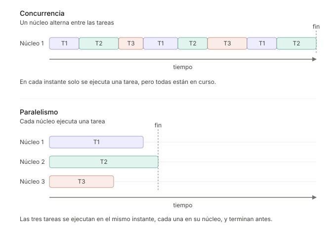
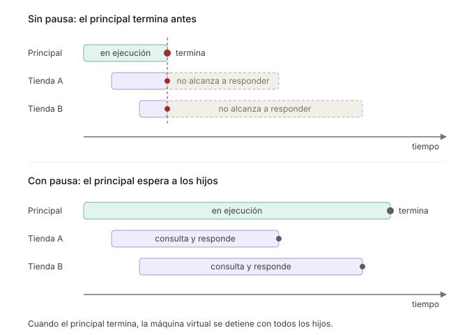
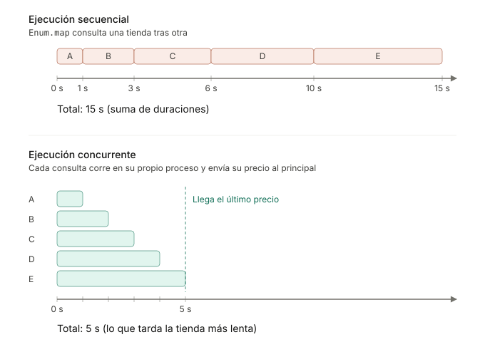
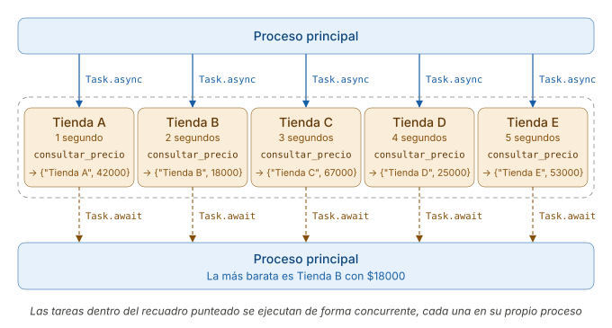
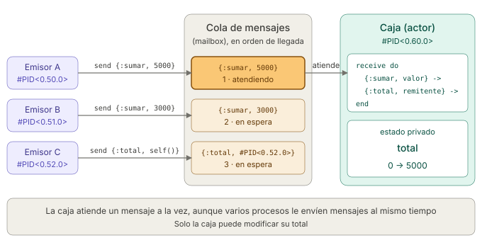

# Procesos

Hasta ahora, todos los programas que hemos hecho se han ejecutado de forma secuencial. Cada instrucción espera a que termine la anterior, y eso funciona bien mientras cada paso tome poco tiempo. Sin embargo, muchos programas pasan buena parte de su tiempo esperando, por ejemplo la respuesta de un servidor, de una base de datos o de otro computador en la red, y mientras esperan no hacen nada más.

Elixir resuelve este problema con **procesos**, que son unidades de ejecución ligeras que avanzan al mismo tiempo, no comparten memoria y se comunican enviándose mensajes. Sobre ellos se construyen también las aplicaciones distribuidas y los supervisores de Elixir.

---

## Ejemplo 1: Un comparador de precios

Suponga que se quiere construir un comparador de precios. El programa consulta el precio de un producto en cinco tiendas en línea y al final muestra cuál lo vende más barato. Cada tienda tarda un tiempo distinto en responder, entre uno y cinco segundos, así que la consulta se simula con `:timer.sleep/1`.

### Versión 1: Una tienda tras otra

```elixir
defmodule Comparador do
  def main do
    tiendas = tiendas_disponibles()

    consultar_precios(tiendas)
    |> buscar_mas_barata()
    |> mostrar_resultado()
  end

  # Cada tienda con los segundos que tarda en responder
  defp tiendas_disponibles do
    [{"Tienda A", 1}, {"Tienda B", 2}, {"Tienda C", 3}, {"Tienda D", 4}, {"Tienda E", 5}]
  end

  defp consultar_precios(tiendas) do
    Enum.map(tiendas, fn {tienda, segundos} -> consultar_precio(tienda, segundos) end)
  end

  # Simula la consulta del precio en una tienda que tarda `segundos` en responder
  defp consultar_precio(tienda, segundos) do
    IO.puts("Consultando #{tienda}...")
    :timer.sleep(segundos * 1000)
    precio = :rand.uniform(100) * 1000
    IO.puts("#{tienda} respondió: $#{precio}")
    {tienda, precio}
  end

  defp buscar_mas_barata(precios) do
    Enum.min_by(precios, fn {_tienda, precio} -> precio end)
  end

  defp mostrar_resultado({tienda, precio}) do
    IO.puts("La más barata es #{tienda} con $#{precio}")
  end
end

Comparador.main()
```

Ejecute el código y cuente cuánto tarda en mostrar el resultado. Los precios son aleatorios, así que cambian en cada ejecución:

```salida
Consultando Tienda A...
Tienda A respondió: $16000
Consultando Tienda B...
Tienda B respondió: $55000
Consultando Tienda C...
Tienda C respondió: $42000
Consultando Tienda D...
Tienda D respondió: $8000
Consultando Tienda E...
Tienda E respondió: $71000
La más barata es Tienda D con $8000
```

**El problema de esta versión.** El programa tarda unos **15 segundos**, la suma de lo que tarda cada tienda (1 + 2 + 3 + 4 + 5). Cada consulta espera a que termine la anterior, aunque ninguna necesita el resultado de otra. Además, durante casi todo ese tiempo el programa no hace nada, solo espera a que cada tienda responda.

Entonces, ¿por qué la consulta a la Tienda B tiene que esperar a que responda la Tienda A? Si las cinco consultas avanzaran al mismo tiempo, el programa tardaría lo que tarda la tienda más lenta, es decir, cinco segundos. Para lograrlo se necesita **concurrencia**.

### Concurrencia, paralelismo y procesos

La **concurrencia** es la capacidad de un sistema para atender varias tareas durante un mismo periodo de tiempo. Estas tareas no tienen que ejecutarse en el mismo instante. Basta con que el sistema organice su ejecución de manera que puedan avanzar sin necesidad de que una termine antes de que comience otra.

Un ejemplo es un sistema operativo que mantiene en ejecución un reproductor de música, un navegador y un editor de texto. Aunque el equipo tenga un solo núcleo, el sistema operativo puede alternar entre los programas y repartir el tiempo de CPU entre ellos, dando la impresión de que se ejecutan simultáneamente.

El **paralelismo**, en cambio, consiste en ejecutar varias tareas en el mismo instante, cada una en una unidad de procesamiento distinta, como los núcleos de un procesador. Por eso depende del hardware. Con un solo núcleo puede haber concurrencia, pero no paralelismo.

El siguiente diagrama compara los dos casos:



En el comparador, la mejora no depende de cuántos núcleos tenga el equipo. Mientras una consulta espera la respuesta de su tienda, no usa la CPU, así que el núcleo queda libre para atender las demás consultas. Por eso, incluso con un solo núcleo, las cinco consultas pueden estar esperando a la vez.

En los sistemas operativos, un **proceso** es un programa en ejecución que tiene su propia memoria y es independiente de los demás. Elixir toma esa misma idea, pero sus procesos no son del sistema operativo, sino **procesos ligeros gestionados por la máquina virtual BEAM**. Cada uno ocupa apenas unos kilobytes, así que un programa puede crear miles de ellos sin problema. En Elixir, la concurrencia se consigue creando procesos. Además, la BEAM reparte los procesos entre los núcleos disponibles, de modo que si hay varios, también se ejecutan en paralelo sin que haya que cambiar el código.

### Versión 2: Un proceso por tienda

Al ejecutar un programa se crea automáticamente un **proceso principal**, y todo el código que hemos escrito hasta ahora corre dentro de él. Para crear otro proceso se usa `spawn/1`, que recibe una función anónima y la ejecuta en un **proceso nuevo**, llamado proceso hijo. El proceso principal no espera a que el hijo termine, sino que sigue de inmediato con la siguiente instrucción.

`spawn/1` devuelve el **PID** (*Process Identifier*) del proceso creado, un identificador único que sirve para referirse a él. Un proceso también puede conocer su propio PID con `self/0`.

Cree un nuevo script de Elixir con el siguiente código. `lanzar_consultas/1` usa `Enum.each` en lugar de `Enum.map` porque no hay resultados que recoger. `spawn` devuelve el PID del proceso, no el precio que este consulta, y aquí el PID solo se usa para imprimirlo:

```elixir
defmodule Comparador do
  def main do
    tiendas = tiendas_disponibles()
    # Se imprime el PID del proceso principal, que es el que ejecuta main
    IO.inspect(self(), label: "Proceso principal")

    lanzar_consultas(tiendas)
    IO.puts("Programa finalizado")
  end

  defp tiendas_disponibles do
    [{"Tienda A", 1}, {"Tienda B", 2}, {"Tienda C", 3}, {"Tienda D", 4}, {"Tienda E", 5}]
  end

  # Crea un proceso por cada tienda
  defp lanzar_consultas(tiendas) do
    Enum.each(tiendas, fn {tienda, segundos} ->
      # Cada proceso tiene su propio PID, que se imprime para ver que son distintos
      pid = spawn(fn -> consultar_precio(tienda, segundos) end)
      IO.puts("#{tienda} se consulta en el proceso #{inspect(pid)}")
    end)
  end

  defp consultar_precio(tienda, segundos) do
    IO.puts("Consultando #{tienda}...")
    :timer.sleep(segundos * 1000)
    precio = :rand.uniform(100) * 1000
    IO.puts("#{tienda} respondió: $#{precio}")
    {tienda, precio}
  end
end

Comparador.main()
```

Un PID no se puede interpolar directamente en una cadena, por eso se usa `inspect/1`, que lo convierte en un texto como `#PID<0.101.0>`.

Al ejecutarlo, la salida es parecida a esta:

```salida
Proceso principal: #PID<0.94.0>
Tienda A se consulta en el proceso #PID<0.101.0>
Consultando Tienda A...
Tienda B se consulta en el proceso #PID<0.102.0>
Consultando Tienda B...
Tienda C se consulta en el proceso #PID<0.103.0>
Consultando Tienda C...
Tienda D se consulta en el proceso #PID<0.104.0>
Consultando Tienda D...
Tienda E se consulta en el proceso #PID<0.105.0>
Consultando Tienda E...
Programa finalizado
```

Cada consulta corre en un proceso distinto, con su propio PID, y las cinco empiezan casi al mismo tiempo. Pero **ninguna tienda responde**, y el programa termina al instante.

Un proceso hijo no depende de quien lo creó, y sigue su camino por su cuenta. Sin embargo, cuando se ejecuta un script con `elixir`, la máquina virtual se detiene en cuanto el proceso principal termina, y con ella se detienen **todos los procesos**, hayan terminado su tarea o no. Aquí el principal crea los cinco procesos, imprime `Programa finalizado` y termina, mucho antes de que pase el primer segundo.



Lo que acaba de ocurrir es el caso sin pausa del diagrama. Para que los hijos alcancen a responder, hay que darles tiempo. Agregue una pausa en `main`, antes de `IO.puts("Programa finalizado")`:

```elixir
:timer.sleep(3500) # Espera a que las consultas terminen
```

Ahora, a los 3,5 segundos ya respondieron las tiendas A, B y C, algo que en la Versión 1 tomaba 6 segundos.

**El problema de esta versión.** Las tiendas D y E nunca responden, porque tardan más que la pausa. El `:timer.sleep(3500)` es una suposición, y si se cambia por `:timer.sleep(6000)` funciona hasta que alguna tienda tarde más. Además, el proceso principal no recibe los precios, así que no puede decir cuál tienda es la más barata. Cada precio se queda en el proceso que lo consultó.

¿Y si la pausa no terminara nunca? `:timer.sleep(:infinity)` bloquea el proceso para siempre. Cambie la pausa por esta y ejecute el código. Las cinco tiendas responden, pero `Programa finalizado` nunca aparece y hay que detener el programa con `Ctrl+C`. Tampoco resuelve el problema, porque el proceso principal sigue sin saber cuándo terminaron las consultas.

#### ¿Y si una tienda falla?

Los procesos traen otra ventaja además de la velocidad. Suponga que la Tienda C está caída y su consulta lanza un error. En la Versión 2, reemplace `lanzar_consultas/1` por esta versión y cambie la pausa de `main` por `:timer.sleep(5500)`, para que alcancen a responder todas las demás:

```elixir
# Crea un proceso por cada tienda
defp lanzar_consultas(tiendas) do
  Enum.each(tiendas, fn {tienda, segundos} ->
    pid =
      spawn(fn ->
        if tienda == "Tienda C", do: raise("La #{tienda} no responde")
        consultar_precio(tienda, segundos)
      end)
    IO.puts("#{tienda} se consulta en el proceso #{inspect(pid)}")
  end)
end
```

Al ejecutarlo, aparece el error de la Tienda C, con el PID de su proceso, pero las otras cuatro tiendas responden y el programa llega hasta el final. Estas son las últimas líneas de la salida:

```salida
[error] Process #PID<0.103.0> raised an exception
** (RuntimeError) La Tienda C no responde
Tienda A respondió: $16000
Tienda B respondió: $55000
Tienda D respondió: $8000
Tienda E respondió: $71000
Programa finalizado
```

En la Versión 1, el mismo error habría detenido todo el programa y las tiendas D y E nunca se habrían consultado. En la Versión 2, como cada proceso está **aislado**, el fallo de uno no afecta a los demás.

### Versión 3: Los precios vuelven al principal

Los procesos en Elixir no comparten variables, así que se comunican enviándose **mensajes**. Cada proceso tiene una **cola de mensajes** (*mailbox*) donde se guardan los mensajes que le llegan de otros procesos.

* Para enviar un mensaje se usa `send/2`, que recibe el PID del proceso receptor y el mensaje. El envío es **asíncrono**, porque `send` deja el mensaje en la cola del receptor y el emisor sigue de inmediato, sin esperar a que el receptor lo lea.
* Para recibirlo se usa `receive`, que toma el primer mensaje de la cola que coincida con alguno de sus patrones. La recepción es **bloqueante**, porque si no hay ningún mensaje que coincida, el proceso se detiene y espera hasta que llegue.

Con mensajes se resuelven los dos problemas de la Versión 2. Cada consulta le envía su precio al proceso principal, así que el principal ya puede saber cuál tienda es la más barata. Además, en lugar de una pausa fija con `:timer.sleep`, el principal espera un mensaje por cada tienda, de modo que no termina hasta que todas hayan respondido.

En el archivo de la Versión 2, cambie `main` y `lanzar_consultas`, y agregue `recibir_precios/1`, `buscar_mas_barata/1` y `mostrar_resultado/1`:

```elixir
defmodule Comparador do
  def main do
    tiendas = tiendas_disponibles()
    principal = self()  # PID del proceso principal, para que las consultas sepan a quién responder

    lanzar_consultas(tiendas, principal)

    tiendas
    |> recibir_precios()
    |> buscar_mas_barata()
    |> mostrar_resultado()
  end

  defp lanzar_consultas(tiendas, principal) do
    Enum.each(tiendas, fn {tienda, segundos} ->
      spawn(fn ->
        resultado = consultar_precio(tienda, segundos)
        send(principal, {:precio, resultado}) # Le envía el precio al proceso principal
      end)
    end)
  end

  # Espera un mensaje por cada tienda
  defp recibir_precios(tiendas) do
    Enum.map(tiendas, fn _tienda ->
      receive do
        {:precio, resultado} -> resultado
      end
    end)
  end

  defp buscar_mas_barata(precios) do
    Enum.min_by(precios, fn {_tienda, precio} -> precio end)
  end

  defp mostrar_resultado({tienda, precio}) do
    IO.puts("La más barata es #{tienda} con $#{precio}")
  end

  # tiendas_disponibles/0 y consultar_precio/2 quedan igual que en la Versión 2
end
```

Ejecute el código. Responden las cinco tiendas, el programa muestra la más barata y tarda unos **5 segundos**, lo que tarda la tienda más lenta:

```salida
Consultando Tienda A...
Consultando Tienda B...
Consultando Tienda C...
Consultando Tienda D...
Consultando Tienda E...
Tienda A respondió: $16000
Tienda B respondió: $55000
Tienda C respondió: $42000
Tienda D respondió: $8000
Tienda E respondió: $71000
La más barata es Tienda D con $8000
```

Compare esta salida con la de la Versión 1. Las cinco consultas empiezan al mismo tiempo, y las respuestas llegan una por segundo, según lo que tarda cada tienda. Ya no hay que adivinar cuánto esperar, porque cada `receive` espera hasta que llegue un precio.

> ⚠️ **Importante:** el PID del proceso principal se guarda en `principal` **antes** de llamar a `spawn`. Dentro de la función del `spawn`, `self()` devolvería el PID del proceso hijo, así que con `send(self(), ...)` cada consulta se enviaría el precio a sí misma y el principal se quedaría esperando para siempre.

¿Por qué el mensaje es `{:precio, resultado}` y no solo `resultado`? Aquí el principal solo recibe precios, así que también funcionaría. Sin embargo, en Elixir se acostumbra **etiquetar** cada mensaje con un átomo que indica de qué tipo es. Así, cuando un proceso recibe mensajes de varios tipos, cada patrón del `receive` reconoce el suyo.

El siguiente diagrama compara los tiempos de la Versión 1 y la Versión 3. Cada barra es la consulta a una tienda, de la A a la E:



**El problema de esta versión.** El comparador funciona, pero hay que encargarse de varios detalles a mano. Hay que guardar el PID del principal, enviar el resultado con `send` y escribir un `receive` por cada tienda.

### Versión 4: El comparador con `Task`

El módulo `Task` permite ejecutar una función en otro proceso y recoger su resultado cuando esté listo, sin escribir `send` ni `receive`. Sus funciones más comunes son:

- `Task.async/1`: crea un proceso que ejecuta la función y devuelve un struct `Task` que lo identifica.
- `Task.await/2`: espera a que ese proceso termine y devuelve el valor que retornó la función. El segundo argumento es el tiempo máximo de espera en milisegundos, y si se omite es de 5 segundos.

En el archivo de la Versión 3, cambie `main` y `lanzar_consultas`, y reemplace `recibir_precios/1` por `esperar_precios/1`:

```elixir
defmodule Comparador do
  def main do
    tiendas = tiendas_disponibles()

    lanzar_consultas(tiendas)
    |> esperar_precios()
    |> buscar_mas_barata()
    |> mostrar_resultado()
  end

  # Lanza las cinco consultas al mismo tiempo
  defp lanzar_consultas(tiendas) do
    Enum.map(tiendas, fn {tienda, segundos} ->
      Task.async(fn -> consultar_precio(tienda, segundos) end)
    end)
  end

  # Espera el precio de cada consulta
  defp esperar_precios(tareas) do
    Enum.map(tareas, fn tarea -> Task.await(tarea) end)
  end

  # tiendas_disponibles/0, consultar_precio/2, buscar_mas_barata/1 y mostrar_resultado/1 quedan igual
end
```

Ejecute el código y compárelo con la Versión 3. La salida es la misma y tarda lo mismo, unos **5 segundos**, pero en el código ya no aparecen `self()`, `send` ni `receive`. Por dentro, `Task` hace lo mismo que se hizo a mano, porque el proceso de la tarea le envía su resultado a quien la creó, y `Task.await` lo recibe.

El siguiente diagrama muestra esa estructura:



> ⚠️ **Importante:** si agrega una tienda que tarde más de 5 segundos, recuerde el límite de `Task.await`. Si la tarea no termina a tiempo, el programa se detiene con el error `** (exit) exited in: Task.await(..., 5000)`. Para esperar más, indique el tiempo, por ejemplo `Task.await(tarea, 10_000)`.

#### ¿Y si una tienda falla con `Task`?

Repita el experimento de la tienda caída, pero ahora en la Versión 4. Reemplace la función `lanzar_consultas` por esta:

```elixir
defp lanzar_consultas(tiendas) do
  Enum.map(tiendas, fn {tienda, segundos} ->
    Task.async(fn ->
      if tienda == "Tienda C", do: raise("La #{tienda} no responde")
      consultar_precio(tienda, segundos)
    end)
  end)
end
```

Ejecute el código y compárelo con la Versión 2. Esta vez el programa completo se detiene y ninguna tienda alcanza a responder. `Task.async` crea un **vínculo** (*link*) entre la tarea y el proceso que la creó, porque asume que su resultado es necesario. Cuando uno de dos procesos vinculados termina por un error, el otro también termina. Por eso, si la tarea falla, el proceso que la creó falla también, en lugar de quedarse esperando un resultado que nunca llegará.

Por eso `spawn` y `Task` no son intercambiables. `spawn` sirve para procesos independientes, cuyo fallo no debe afectar a nadie. `Task` sirve para tareas cuyo resultado se necesita.

---

## Ejemplo 2: Una caja registradora

En el comparador, cada consulta hace un solo trabajo. Calcula un precio, lo entrega y termina. Otros procesos no terminan al hacer su trabajo, sino que siguen activos atendiendo los mensajes que les llegan. Se les conoce como procesos de **larga duración**.

Es el caso de una caja registradora. Recibe las ventas de la tienda, las va sumando y, cuando alguien lo pide, informa el total vendido. El problema es dónde guardar ese total. En Elixir los datos no se modifican, así que no puede haber una variable `total` que cambie con cada venta. La solución es que la caja sea un proceso que conserve el total entre un mensaje y otro.

### Versión 1: Una caja que atiende una venta

Se empieza por lo más simple. La caja es un proceso que espera un mensaje `{:sumar, valor}` e imprime la venta registrada:

```elixir
defmodule CajaRegistradora do
  def main do
    IO.puts("Iniciando caja registradora")
    caja = abrir()

    # El proceso principal le envía una venta a la caja
    send(caja, {:sumar, 5000})
    # Este segundo mensaje llega al mailbox, pero la caja ya no lo atiende
    send(caja, {:sumar, 3000})

    IO.puts("Ventas enviadas a la caja")

    # Da tiempo a la caja de atender el mensaje antes de que el programa termine
    :timer.sleep(100)
    IO.puts("Fin de la jornada")
  end

  # Crea el proceso receptor, que espera un mensaje en su mailbox
  defp abrir do
    spawn(fn ->
      receive do
        {:sumar, valor} -> # Si el mensaje coincide con el patrón, lo atiende
          IO.puts("Venta registrada por $#{valor}")
      end
    end)
  end
end

CajaRegistradora.main()
```

Al ejecutarlo, la salida es:

```salida
Iniciando caja registradora
Ventas enviadas a la caja
Venta registrada por $5000
Fin de la jornada
```

**El problema de esta versión.** La caja atiende una sola venta. La de $3000 no aparece, porque un `receive` atiende un solo mensaje, y después la caja termina.

### Versión 2: Atender muchas ventas y llevar el total

**Nuevo requerimiento:** la caja debe atender todas las ventas de la jornada y llevar el total vendido.

Para que un proceso reciba múltiples mensajes se utiliza un **bucle recursivo**, que vuelve a esperar después de atender cada mensaje. Ese mismo bucle permite que la caja lleve el total vendido, porque el total viaja como argumento de una llamada a la siguiente:

```elixir
defmodule CajaRegistradora do
  def main do
    IO.puts("Iniciando caja registradora")
    caja = abrir()
    enviar_mensajes(caja)

    # Da tiempo a la caja de atender los mensajes antes de que el programa termine
    :timer.sleep(100)
    IO.puts("Fin de la jornada")
  end

  defp enviar_mensajes(caja) do
    send(caja, {:sumar, 5000})
    send(caja, {:sumar, 3000})
    send(caja, :mostrar)
    send(caja, :cerrar)
  end

  # Crea el proceso con un total inicial de 0
  defp abrir do
    spawn(fn -> loop(0) end)
  end

  defp loop(total) do
    receive do
      {:sumar, valor} ->
        IO.puts("Venta registrada por $#{valor}")
        loop(total + valor) # Vuelve a esperar otro mensaje, ahora con el total actualizado
      :mostrar ->
        IO.puts("Total vendido: $#{total}")
        loop(total)
      :cerrar ->
        IO.puts("Caja cerrada")
        :ok # No vuelve a llamar a loop, así que el proceso termina
    end
  end
end

CajaRegistradora.main()
```

Al ejecutarlo, la salida es:

```salida
Iniciando caja registradora
Venta registrada por $5000
Venta registrada por $3000
Total vendido: $8000
Caja cerrada
Fin de la jornada
```

Esta vez la caja recibe los cuatro mensajes y los atiende uno tras otro, en el orden en que llegaron a su cola. Cada mensaje se compara con los patrones del `receive`, y se ejecuta la rama del primero que coincida.

### Versión 3: La caja responde

**Nuevo requerimiento:** el total vendido debe llegar al proceso principal, para que pueda usarlo y no solo verlo en pantalla.

Además, las dos versiones anteriores todavía terminan con un `:timer.sleep(100)`, porque el proceso principal no tiene forma de saber cuándo la caja terminó.

La solución para las dos cosas es que la caja **responda con otro mensaje**, siguiendo un patrón conocido como **petición y respuesta**. Quien pregunta envía su propio PID dentro del mensaje, la caja le responde a ese PID y quien preguntó espera la respuesta con `receive`.

En el archivo de la Versión 2, cambie `main`, reemplace `enviar_mensajes` por `registrar_ventas`, agregue `consultar_total/1` y `cerrar/1`, y modifique `loop/1`:

```elixir
defmodule CajaRegistradora do
  def main do
    IO.puts("Iniciando caja registradora")
    caja = abrir()
    registrar_ventas(caja)

    total = consultar_total(caja)
    IO.puts("La caja respondió que el total vendido es $#{total}")

    cerrar(caja)
  end

  # Crea el proceso con un total inicial de 0
  defp abrir do
    spawn(fn -> loop(0) end)
  end

  defp registrar_ventas(caja) do
    send(caja, {:sumar, 5000})
    send(caja, {:sumar, 3000})
  end

  defp consultar_total(caja) do
    # Le pide el total a la caja, indicándole a quién debe responder
    send(caja, {:total, self()})

    # Espera la respuesta en el mailbox del proceso principal
    receive do
      {:total, total} -> total
    end
  end

  defp cerrar(caja) do
    send(caja, {:cerrar, self()})

    # Espera a que la caja confirme que cerró
    receive do
      :cerrada -> :ok
    end
  end

  defp loop(total) do
    receive do
      {:sumar, valor} ->
        IO.puts("Venta registrada por $#{valor}")
        loop(total + valor)
      # Reemplaza a :mostrar, porque ahora el total se envía en lugar de imprimirse
      {:total, remitente} ->
        send(remitente, {:total, total}) # Le responde al proceso que preguntó
        loop(total)
      {:cerrar, remitente} ->
        IO.puts("Caja cerrada")
        send(remitente, :cerrada) # Confirma el cierre después de imprimir
        :ok # No vuelve a llamar a loop, así que el proceso termina
    end
  end
end
```

Al ejecutarlo, la salida es:

```salida
Iniciando caja registradora
Venta registrada por $5000
Venta registrada por $3000
La caja respondió que el total vendido es $8000
Caja cerrada
```

Ya no hace falta la pausa, porque cada `receive` del proceso principal espera exactamente hasta que llegue la respuesta. Como la caja atiende los mensajes en orden, cuando responde el total ya sumó las dos ventas.

En `loop/1` cambian dos ramas. `{:total, remitente}` reemplaza a `:mostrar`, porque las dos informan el total, pero `:mostrar` solo lo imprimía, mientras que `{:total, remitente}` se lo entrega al proceso que preguntó. `:cerrar` se convierte en `{:cerrar, remitente}` para que la caja confirme el cierre. Sin esa confirmación, el proceso principal podría terminar antes de que la caja alcance a imprimir `Caja cerrada`, y con él terminaría todo el programa.

### Versión 4: Varios vendedores

**Nuevo requerimiento:** en la tienda hay varios vendedores atendiendo al mismo tiempo, y todos le reportan sus ventas a la misma caja.

Hasta ahora el proceso principal hace dos papeles. Es el vendedor que registra las ventas y, a la vez, quien consulta el total. En esta versión cada vendedor será un proceso, y el proceso principal solo consultará el total y cerrará la caja al final de la jornada.

Cada vendedor necesita dos PID, el de la caja, para enviarle sus ventas, y el del principal, para avisarle que terminó. En el archivo de la Versión 3, cambie `main` y reemplace `registrar_ventas` por `crear_vendedor/4` y `esperar_vendedores/1`:

```elixir
defmodule CajaRegistradora do
  def main do
    IO.puts("Iniciando caja registradora")
    caja = abrir()
    principal = self()  # PID del proceso principal, para que los vendedores le avisen

    crear_vendedor("Carlos", [5000, 3000], caja, principal)
    crear_vendedor("Luis", [2000], caja, principal)
    esperar_vendedores(2)

    total = consultar_total(caja)
    IO.puts("La caja respondió que el total vendido es $#{total}")

    cerrar(caja)
  end

  # Crea un proceso que le envía sus ventas a la caja y luego le avisa al principal
  defp crear_vendedor(nombre, ventas, caja, principal) do
    spawn(fn ->
      Enum.each(ventas, fn valor -> send(caja, {:sumar, valor}) end)
      send(principal, {:listo, nombre})
    end)
  end

  # Espera un aviso por cada vendedor, como el comparador esperaba un precio por cada tienda
  defp esperar_vendedores(0), do: :ok

  defp esperar_vendedores(pendientes) do
    receive do
      {:listo, nombre} -> IO.puts("#{nombre} terminó de vender")
    end

    esperar_vendedores(pendientes - 1)
  end

  # abrir/0, consultar_total/1, cerrar/1 y loop/1 quedan igual
end
```

Al ejecutarlo, la salida es:

```salida
Iniciando caja registradora
Carlos terminó de vender
Luis terminó de vender
Venta registrada por $5000
Venta registrada por $3000
Venta registrada por $2000
La caja respondió que el total vendido es $10000
Caja cerrada
```

El orden de algunas líneas puede cambiar de una ejecución a otra, pero el total siempre es $10000. Observe que los vendedores avisan que terminaron **antes** de que aparezcan las ventas registradas. Que un vendedor termine significa que ya dejó sus ventas en la cola de la caja, no que la caja ya las haya atendido. Aun así, el total es correcto, porque la pregunta `{:total, self()}` llega a la cola después de todas las ventas, y la caja atiende los mensajes en orden.

#### ¿Y si no se espera a los vendedores?

En `main`, comente la línea `esperar_vendedores(2)` y ejecute el código de nuevo. Elixir mostrará una advertencia porque `esperar_vendedores/1` ya no se usa, que puede ignorar. Lo más probable es que la salida sea esta:

```salida
Iniciando caja registradora
La caja respondió que el total vendido es $0
Venta registrada por $5000
Venta registrada por $3000
Venta registrada por $2000
Caja cerrada
```

El proceso principal crea los vendedores y pregunta el total de inmediato, antes de que ellos alcancen a enviar sus ventas. La pregunta llega primero a la cola de la caja, que responde con lo que lleva hasta ese momento. Las ventas sí se registran, pero después de que el total ya se informó.

> ⚠️ **Importante:** el resultado podría ser otro, por ejemplo \$5000 o \$10000, según cómo la BEAM reparta el tiempo de CPU entre los procesos. **Nada garantiza** en qué orden avanzan procesos distintos, y por eso **no se debe depender del orden de ejecución entre procesos**. Si un proceso necesita saber que otro ya terminó, debe enterarse **por un mensaje**, como hace el principal con el aviso `{:listo, nombre}` de cada vendedor, no por suposiciones de tiempo.

**El problema de esta versión.** El PID de la caja pasa de `main` a cada llamada de `crear_vendedor`, y también a `consultar_total` y `cerrar`. En un programa más grande, cualquier parte que quiera registrar una venta tendría que recibir ese PID.

### Versión 5: Un nombre para la caja

El módulo `Process` evita eso porque permite **registrar un proceso con un nombre**. `Process.register/2` le asigna el nombre `:caja`, y desde ese momento cualquier proceso puede escribir `send(:caja, mensaje)`, que funciona igual que con el PID. El módulo también trae funciones para inspeccionar un proceso. `Process.whereis/1` devuelve el PID registrado con un nombre, y `Process.alive?/1` indica si el proceso sigue activo.

En el archivo de la Versión 4, cambie `abrir/0` para que registre la caja, quite el parámetro `caja` de las funciones que lo recibían y agregue `inspeccionar/0`:

```elixir
defmodule CajaRegistradora do
  def main do
    IO.puts("Iniciando caja registradora")
    abrir()
    inspeccionar()
    principal = self()

    crear_vendedor("Carlos", [5000, 3000], principal)
    crear_vendedor("Luis", [2000], principal)
    esperar_vendedores(2)

    total = consultar_total()
    IO.puts("La caja respondió que el total vendido es $#{total}")

    cerrar()
  end

  # Crea el proceso de la caja y lo registra con el nombre :caja
  defp abrir do
    pid = spawn(fn -> loop(0) end)
    Process.register(pid, :caja)
  end

  # Se inspecciona el proceso con funciones del módulo Process
  defp inspeccionar do
    pid = Process.whereis(:caja)
    IO.puts("La caja está registrada con el PID #{inspect(pid)}")
    IO.puts("¿La caja está abierta? #{Process.alive?(pid)}")
  end

  # El vendedor le habla a la caja por su nombre, sin necesidad de conocer su PID
  defp crear_vendedor(nombre, ventas, principal) do
    spawn(fn ->
      Enum.each(ventas, fn valor -> send(:caja, {:sumar, valor}) end)
      send(principal, {:listo, nombre})
    end)
  end

  defp consultar_total do
    send(:caja, {:total, self()})

    receive do
      {:total, total} -> total
    end
  end

  defp cerrar do
    send(:caja, {:cerrar, self()})

    receive do
      :cerrada -> :ok
    end
  end

  # esperar_vendedores/1 y loop/1 quedan igual
end
```

Al ejecutarlo, la salida es la misma de la Versión 4, con dos líneas nuevas al principio:

```salida
Iniciando caja registradora
La caja está registrada con el PID #PID<0.101.0>
¿La caja está abierta? true
Carlos terminó de vender
...
```

El número del PID puede cambiar de una ejecución a otra. Para conocer las demás funciones del módulo, por ejemplo `Process.info/2`, que consulta información como cuántos mensajes tiene pendientes un proceso, puede consultar la [documentación oficial de Process](https://hexdocs.pm/elixir/Process.html).

### Versión 6 (reto)

**Nuevo requerimiento:** además del total, la caja debe informar cuántas ventas ha registrado.

Agregue una consulta `{:ventas, remitente}` que funcione igual que `{:total, remitente}`, y una función `consultar_ventas/0` en el proceso principal, que se llame después de `consultar_total/0`.

*Pista:* el estado de la caja ya no puede ser solo un número. `loop/1` puede recibir una tupla `{total, ventas}`, y `abrir/0` debe iniciar la caja con `{0, 0}`.

Con los vendedores de la Versión 5, la salida de `main` debe terminar así:

```salida
La caja respondió que el total vendido es $10000
Ventas registradas: 3
Caja cerrada
```

---

## El Modelo de Actores

El **Modelo de Actores** es un modelo de computación concurrente propuesto por Carl Hewitt en 1973, sobre el cual están construidos Erlang y Elixir. Su unidad central es el **actor**, una entidad independiente que cumple estas características:

1. **Tiene estado privado.** Nadie más puede leerlo ni cambiarlo. El total de la caja vive dentro de su proceso.
2. **Se comunica solo mediante mensajes.** Para sumar una venta o conocer el total, hay que enviarle un mensaje a la caja.
3. **Atiende un mensaje a la vez.** La caja toma las ventas de su cola una por una.
4. **Puede crear otros actores.** El proceso principal creó la caja, los vendedores y las consultas del comparador con `spawn`.
5. **Está aislado.** Si un actor falla, los demás siguen funcionando, como pasó con la tienda caída del comparador.

En Elixir, todo proceso es un actor. Las consultas del comparador también lo son, aunque solo la caja muestra el modelo completo, porque es la única con estado.

En muchos otros lenguajes, la concurrencia se implementa con **hilos** que comparten la misma memoria. Si dos hilos modifican el mismo dato al mismo tiempo, el resultado puede quedar mal (lo que se conoce como *race condition*). Con actores, ese problema no ocurre sobre el estado, porque ningún proceso puede modificar el de otro. Lo que sí sigue importando es el orden en que llegan los mensajes, como se vio en la Versión 4 de la caja.

El siguiente diagrama lo muestra con la caja. Aunque tres procesos le envíen mensajes al mismo tiempo, los mensajes se acumulan en orden en su cola, y la caja los atiende uno a uno con coincidencia de patrones. Nunca hay dos ventas sumándose a la vez sobre el mismo total.



La siguiente tabla resume las diferencias entre los dos enfoques:

| Característica              | Hilos tradicionales                           | Modelo de Actores                                     |
| --------------------------- | --------------------------------------------- | ----------------------------------------------------- |
| **Memoria**                 | Compartida entre hilos                        | Cada actor tiene la suya                              |
| **Comunicación**            | Leyendo y escribiendo variables compartidas   | Enviando mensajes                                     |
| **Protección de los datos** | Bloqueos (*locks*) puestos por el programador | No hace falta, cada actor atiende un mensaje a la vez |
| **Peso**                    | Pesados (megabytes de memoria)                | Ligeros (kilobytes de memoria)                        |

Por esta razón, un servidor escrito en Elixir puede atender a miles de usuarios de forma simultánea, con un proceso por usuario, sin necesidad de proteger los datos mediante bloqueos.

---

## ¿Cuándo no conviene usar procesos?

Los procesos ayudan cuando hay tareas que no dependen entre sí y que pasan buena parte del tiempo esperando, como las consultas a las tiendas. No ayudan en estos casos:

* **Cuando una tarea necesita el resultado de otra.** Si para consultar la Tienda B se necesitara la respuesta de la Tienda A, la consulta B tendría que esperar de todas formas.
* **Cuando las tareas son muy cortas.** Crear un proceso cuesta poco, pero no es gratis. Duplicar 100.000 números con `Enum.map` es muy rápido, mientras que lanzar un `Task.async` por cada número tarda cientos de milisegundos, porque se gasta más tiempo creando procesos que haciendo el trabajo.

Para profundizar un poco más en la concurrencia en Elixir, puede revisar [esta página de Elixir School](https://elixirschool.com/en/lessons/intermediate/concurrency).

---

## Ejercicios propuestos

### Ejercicio 1: Información de una ruta

Una aplicación de mapas debe mostrarle al usuario el estado del tráfico y el clima de su ruta. Ambas consultas son costosas e independientes entre sí, y se simulan con estas funciones:

```elixir
defmodule Ruta do
  # Simula la consulta del tráfico, que es la más lenta
  def consultar_trafico(via) do
    IO.puts("[Tráfico] Consultando #{via}...")
    :timer.sleep(3000)
    "[Tráfico] Congestión moderada en #{via}"
  end

  # Simula la consulta del clima
  def consultar_clima(ciudad) do
    IO.puts("[Clima] Consultando #{ciudad}...")
    :timer.sleep(1000)
    "[Clima] Lluvia ligera en #{ciudad}"
  end
end
```

1. Escriba una función `mostrar_informacion/0` que haga ambas consultas de forma secuencial e imprima sus resultados.
2. Escriba otra versión que haga las dos consultas de forma concurrente con `Task`, y que mientras tanto imprima un mensaje indicando que el mapa sigue respondiendo.
3. Antes de ejecutarlas, estime cuánto tardará cada versión. Luego compruebe su estimación con `:timer.tc/1`, que recibe una función, la ejecuta y devuelve una tupla `{microsegundos, resultado}`.

### Ejercicio 2: Contador con historial

Cree un script que implemente un actor contador. El actor debe mantener como estado el valor del contador y la lista de operaciones que ha recibido, y debe responder a los siguientes mensajes:

- `{:incrementar, n}`: Incrementa el contador en `n`.
- `{:decrementar, n}`: Decrementa el contador en `n`.
- `{:obtener, pid}`: Envía el valor actual del contador al proceso con PID `pid`.
- `{:historial, pid}`: Envía la lista de operaciones recibidas, en el orden en que llegaron, por ejemplo `[{:incrementar, 5}, {:decrementar, 2}]`.
- `:reiniciar`: Reinicia el contador a 0 y borra el historial.
- `:detener`: Detiene el actor, es decir, el proceso termina sin volver a esperar mensajes.

Registre el actor con un nombre y asegúrese de que su implementación cumpla con las características del Modelo de Actores.

### Ejercicio 3: Pedidos a la cocina

En un restaurante, los meseros le envían los pedidos a la cocina y esperan a que el plato esté listo para llevarlo a la mesa. La cocina es un proceso que recibe mensajes `{:pedido, plato, mesero}`, prepara el plato y le responde al mesero con `{:listo, plato}`. Cada plato tarda un tiempo distinto en prepararse, y si el plato no está en el menú, la cocina no responde nada:

```elixir
defmodule Cocina do
  @tiempos %{"Ensalada" => 1, "Bandeja paisa" => 2, "Ajiaco" => 4}

  def abrir do
    spawn(fn -> loop() end)
  end

  defp loop do
    receive do
      {:pedido, plato, mesero} ->
        preparar(plato, mesero)
        loop()
    end
  end

  defp preparar(plato, mesero) do
    case @tiempos[plato] do
      nil ->
        IO.puts("[Cocina] No hay #{plato}") # No le responde al mesero
      segundos ->
        :timer.sleep(segundos * 1000)
        send(mesero, {:listo, plato})
    end
  end
end
```

Resuelva el ejercicio con `send` y `receive`, sin usar `Task`.

1. Escriba un módulo `Mesero` cuya función `main` abra la cocina, le pida una "Ensalada", espere la respuesta e imprima `[Mesero] Llevando Ensalada a la mesa`. Luego haga lo mismo con una "Bandeja paisa".
2. Agregue un pedido de "Lasaña", que no está en el menú, y ejecute el programa. ¿Qué ocurre? ¿Por qué el programa no termina?
3. Investigue cómo funciona el bloque `after` dentro de `receive` y úselo para que el mesero espere como máximo 3 segundos por cada plato. Si la cocina no responde a tiempo, el mesero debe imprimir `[Mesero] La cocina no respondió por Lasaña` y seguir con el siguiente pedido.
4. Pida un "Ajiaco", que tarda 4 segundos, y justo después una "Ensalada". ¿Qué imprime el mesero en cada pedido? ¿Qué pasó con la respuesta del ajiaco, que llegó tarde? Investigue el operador pin (`^`) y úselo en el patrón del `receive` para que el mesero solo acepte la respuesta del plato que pidió.
5. La cocina espera pedidos sin límite de tiempo, porque su `receive` no tiene `after`. ¿Por qué en su caso eso sí tiene sentido?

### Ejercicio 4: Un comparador que no espera para siempre

En la Versión 3 del comparador, ¿qué pasaría si una tienda nunca respondiera? Use lo que aprendió sobre `after` en el Ejercicio 3 para que el comparador espere cada precio como máximo 6 segundos y muestre la más barata entre las tiendas que sí respondieron a tiempo. Para probarlo, haga que la Tienda C tarde 15 segundos.

Después, cambie el tiempo de la Tienda C a 10 segundos. ¿Su precio llega o no? ¿Por qué, si tarda más de 6 segundos?

---

## Para la próxima clase

- Investigar qué es una aplicación distribuida y cómo pueden comunicarse en Elixir dos procesos que corren en computadores distintos. Puede leer sobre el módulo `Node` en la documentación oficial de Elixir: [https://hexdocs.pm/elixir/Node.html](https://hexdocs.pm/elixir/Node.html).
- Investigar qué es una dirección IP y cómo consultar la IP de su computador en una red local.
